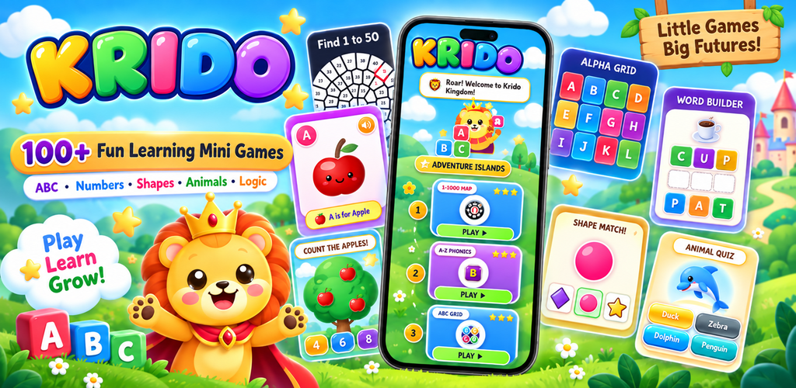
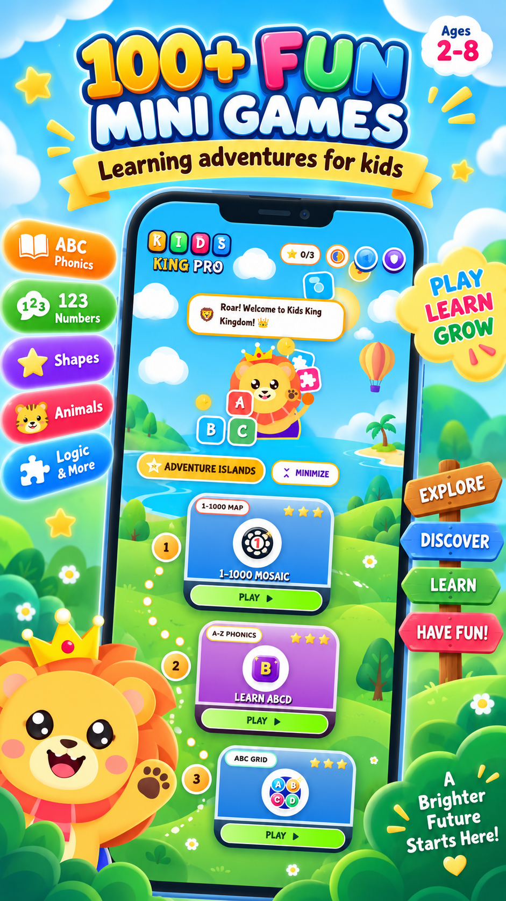
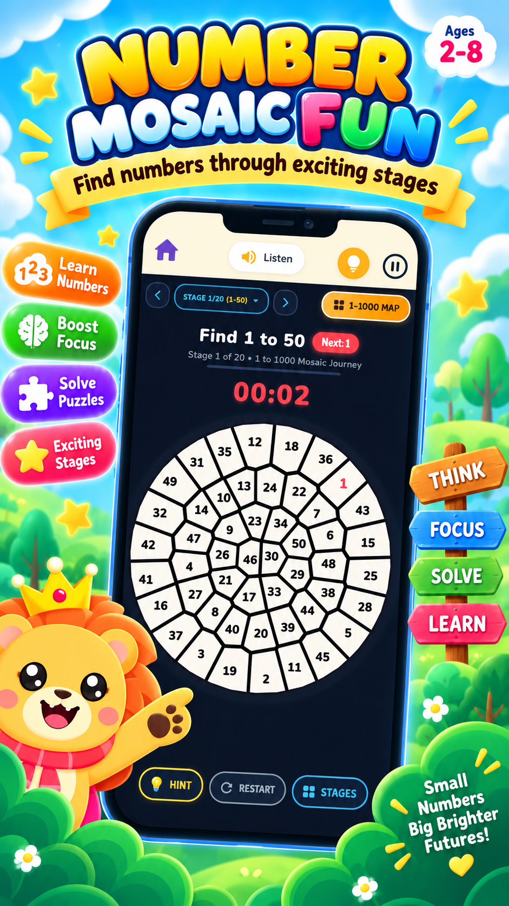
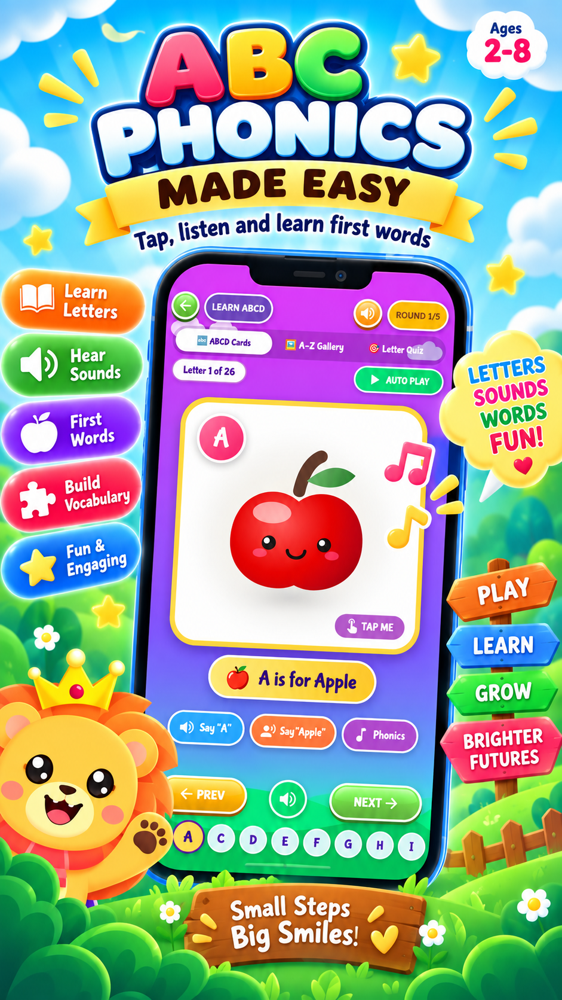
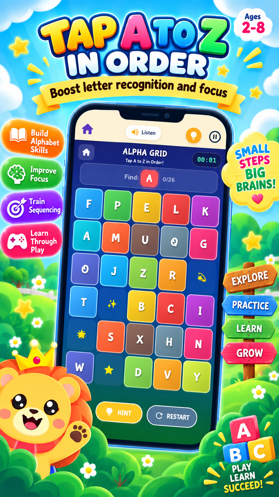
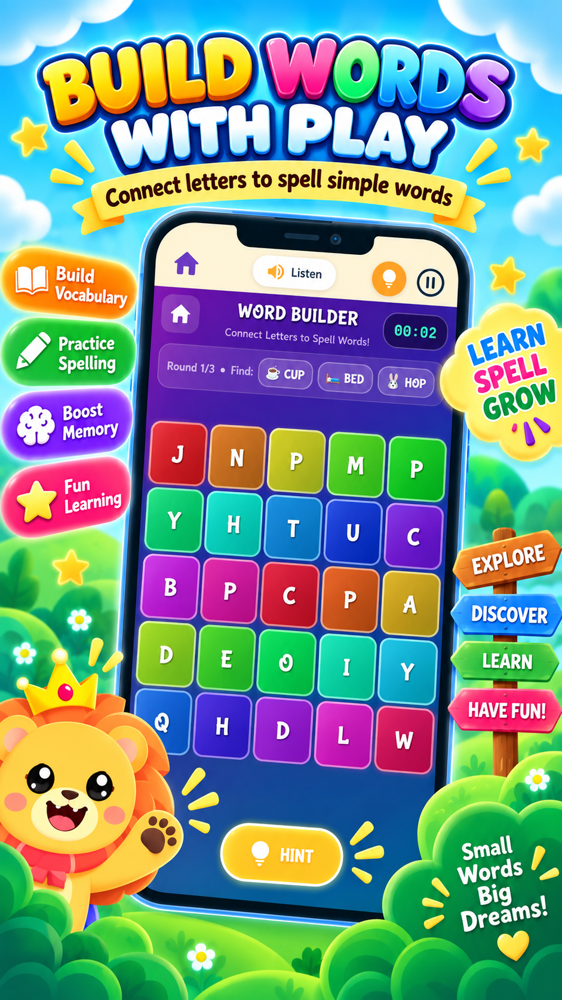
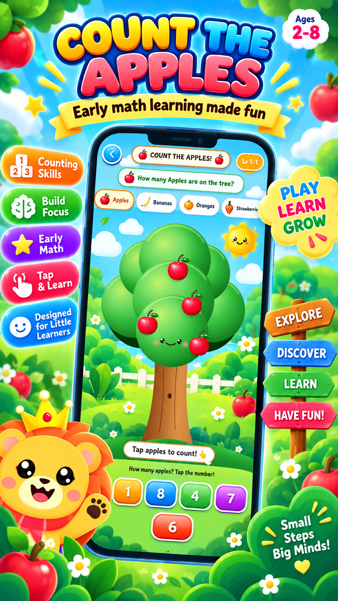
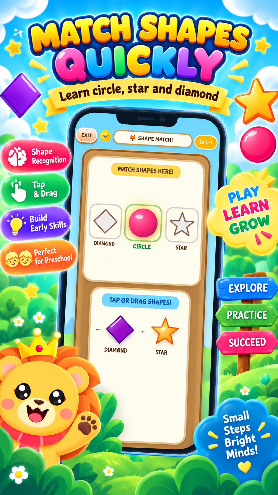
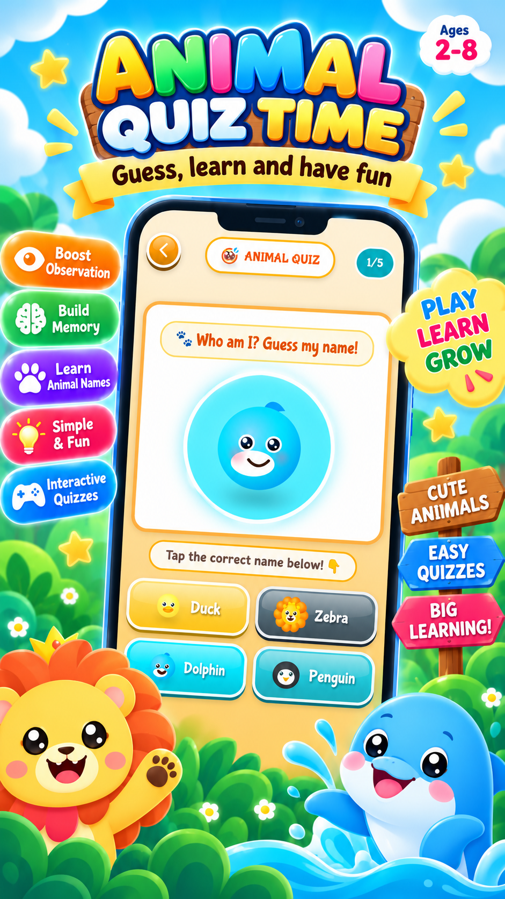

<div align="center">

  

  # 🎮 KRIDO — Kids Early Learning Games
  ### Wholesome, Offline-First Educational Mini-Game Adventure for Ages 3–8

  <p align="center">
    <b>A colorful, cheerful, and ad-safe Flutter app packed with 28+ interactive mini-games. Designed to nurture numbers, letters, logic, science, and creativity in children through short, joyful play sessions.</b>
  </p>

  [](https://flutter.dev)
  [](https://dart.dev)
  [](https://riverpod.dev)
  [](https://github.com/OPSHARP/KRIDO)
  [](https://github.com/OPSHARP/KRIDO)
  [](LICENSE)
  [](https://play.google.com/store/apps/details?id=com.krido.kidsapp)

  <br />

  <a href="https://play.google.com/store/apps/details?id=com.krido.kidsapp">
    
  </a>

  <p>
    🚀 <b>Live Demo Available:</b> <a href="https://play.google.com/store/apps/details?id=com.krido.kidsapp"><b>Download KRIDO on Google Play Store</b></a>
  </p>

  <br />
  

</div>

---

## 📱 Visual Showcase & Screenshots

<div align="center">
  <table>
    <tr>
      <td align="center"><b>Adventure Island</b></td>
      <td align="center"><b>Game Selection</b></td>
      <td align="center"><b>Math & Numbers</b></td>
      <td align="center"><b>Letter Tracing</b></td>
    </tr>
    <tr>
      <td></td>
      <td></td>
      <td></td>
      <td></td>
    </tr>
    <tr>
      <td align="center"><b>Animal Sounds</b></td>
      <td align="center"><b>Xylophone & Music</b></td>
      <td align="center"><b>Space Explorer</b></td>
      <td align="center"><b>Color Mixing Lab</b></td>
    </tr>
    <tr>
      <td></td>
      <td></td>
      <td></td>
      <td></td>
    </tr>
  </table>
</div>

---

## ✨ Key Features & Curriculum

KRIDO is designed around early childhood educational frameworks, encouraging cognitive, motor, linguistic, and sensory development:

### 🔢 Math & Logic Skills
- **Number Circles & Counting Orchard:** Interactive counting with physical visual feedback.
- **Kid Math & Pattern Sequences:** Easy addition, subtraction, shape matching, and pattern recognition.
- **Size Stacker & Sorting Factory:** Classify objects by size, height, color, and category.

### 🔤 Early Literacy & Language
- **Guided Letter Tracing:** Tactile stroke-by-stroke uppercase and lowercase letter tracing.
- **Spelling Puzzles & Phonics:** Drag-and-drop letter assembly with native voice phonics.
- **Rhyming Words & Vocabulary:** Engaging audio-visual associations to build core vocabulary.

### 🎨 Creativity, Music & Sensory
- **Musical Xylophone:** Interactive 8-key colorful musical instrument with realistic pitch tuning.
- **Color Mixing Laboratory:** Experiment by blending primary colors to discover secondary colors.
- **Dino Bone Digger & Space Explorer:** Tap-and-reveal archaeology and planetary exploration quests.

### 🐾 Animals & Nature
- **Animal Sounds & Habitat Match:** Match wildlife to their native habitats (ocean, jungle, desert, arctic).
- **Animal Quiz & Jigsaw Puzzles:** Fine-motor puzzle solving paired with fun facts.

---

## 🛡️ Child Safety & Privacy (COPPA Compliant)

Parents can entrust their children with KRIDO knowing privacy is the core priority:

- 🔒 **100% Offline-First:** No continuous internet connection needed; all 28+ games are self-contained.
- 🚷 **Zero Data Harvesting:** No account sign-ups, no user tracking, no third-party analytics.
- 👨‍👩‍👧 **Parental Gate & Session Timer:** Built-in timer controls (5, 10, 15, 20 mins or unlimited) to prevent excessive screen time.
- 👤 **Local Multi-Profile:** Support for up to 4 local child profiles with custom animal avatars and local progress tracking.
- 📱 **Portrait-Locked Ergonomics:** Perfectly balanced for small hands and one-handed tablet/phone use.

---

## 🛠️ Tech Stack & Architecture

```
KRIDO Architecture (Modular Game Engine)
│
├── core/                # Audio engines, local SQLite database, settings
├── domain/              # Curriculum contracts, progress tracking models
├── features/            # Adventure map, profile switcher, parental area
└── games/
    ├── registry.dart    # Central metadata & curriculum mapping
    ├── game_factory.dart# Dynamic on-demand module loader
    └── modules/         # Standalone, isolated game implementations (g001 - g090)
```

| Component | Technology | Description |
| :--- | :--- | :--- |
| **Framework** | [Flutter](https://flutter.dev) (3.13+) | High-performance cross-platform UI toolkit |
| **Language** | [Dart](https://dart.dev) (3.x) | Null-safe, fast, and expressive |
| **State Management** | [Flutter Riverpod](https://riverpod.dev) (`^3.4.3`) | Reactive, compile-safe dependency injection |
| **Database** | [sqflite](https://pub.dev/packages/sqflite) | Local encrypted database for stars & profiles |
| **Audio Engine** | [audioplayers](https://pub.dev/packages/audioplayers) | Low-latency SFX and cheerful background music |
| **Narration** | [flutter_tts](https://pub.dev/packages/flutter_tts) | Clear voice instructions and positive reinforcement |
| **Typography** | [Google Fonts](https://pub.dev/packages/google_fonts) | Child-friendly fonts with high legibility |

---

## 📁 Repository Structure

```text
lib/
├── main.dart                 # App initialization & startup flow
├── app/                      # Themes, colors, custom typography, route maps
├── core/                     # Shared services (AudioService, DatabaseHelper, Prefs)
├── domain/                   # Achievement contracts, curriculum standards
├── features/                 # Main adventure hub, avatar picker, parental gate
└── games/
    ├── game_factory.dart     # Dynamic game instantiation
    ├── registry.dart         # Game metadata & age-bracket filtering
    └── modules/              # Modular game screens & controllers
        ├── g001_number_pebble_circle/
        ├── g002_count_orchard/
        ├── g073_spelling_puzzle/
        ├── g079_letter_tracing/
        ├── g080_musical_xylophone/
        ├── g083_color_mixing_lab/
        ├── g086_space_explorer/
        └── ... (28+ self-contained modules)
```

---

## 🚀 Getting Started & Local Setup

### Prerequisites
- [Flutter SDK](https://docs.flutter.dev/get-started/install) (`^3.13.0` or higher)
- [Android Studio](https://developer.android.com/studio) / [VS Code](https://code.visualstudio.com/)
- Android SDK (API 26+)

### 1. Clone the Repository
```bash
git clone https://github.com/OPSHARP/KRIDO.git
cd KRIDO
```

### 2. Install Packages
```bash
flutter pub get
```

### 3. Run on Device / Emulator
```bash
flutter run
```

### 4. Build Production Release (Optional)
```bash
flutter build apk --release \
  --dart-define=ADMOB_APP_ID=ca-app-pub-YOUR_ID~YOUR_APP \
  --dart-define=ADMOB_BANNER_ID=ca-app-pub-YOUR_ID/YOUR_BANNER
```

---

## 🤝 Contributing

We welcome contributions from teachers, parents, and developers passionate about early childhood education!
1. Fork the Project
2. Create your Feature Branch (`git checkout -b feature/NewEducationalGame`)
3. Commit your Changes (`git commit -m 'Add new shape puzzle module'`)
4. Push to the Branch (`git push origin feature/NewEducationalGame`)
5. Open a Pull Request

---

## 📜 License

Distributed under the **MIT License**. See [`LICENSE`](LICENSE) for more details.

---

<div align="center">
  Made with ❤️ by <b>OPSHARP</b> for kids and early learners worldwide.
  <br />
  <a href="https://play.google.com/store/apps/details?id=com.krido.kidsapp"><b>Download on Google Play Store</b></a>
</div>
